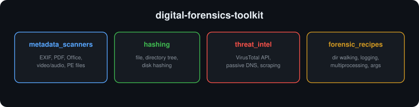

# digital-forensics-toolkit

> Python tools for digital forensics and incident response — file metadata, hashing, and threat intelligence.

   

## About

A toolkit of scripts I built while learning digital forensics: pulling hidden
metadata out of files, hashing files and whole directory trees for integrity
verification, and checking indicators against threat-intelligence sources like
VirusTotal. These are the everyday building blocks of a forensic investigation.

## Categories



## Repository structure

```
digital-forensics-toolkit/
├── metadata_scanners/
│   ├── metadata_pictures.py     # EXIF data from images (+ GPS to KML)
│   ├── metadata_pdf.py          # PDF document metadata
│   ├── metadata_msoffice.py     # Office document metadata
│   ├── metadata_video_audio.py  # Media file metadata (mutagen)
│   └── metadata_executable.py   # PE/executable headers (pefile)
├── hashing/
│   ├── file_hashing.py          # Hash a file's name and contents
│   ├── dir_tree_hash.py         # Hash every file in a directory tree
│   ├── disk_hash.py             # Hash a disk/large source
│   └── hash_algorithms_notes.txt
├── threat_intel/
│   ├── virustotal/              # Query domains/files against the VirusTotal API
│   ├── passive_dns/             # Passive DNS / domain lookups
│   └── beautifulsoup_parser.py  # Scrape/parse web data
├── sample_data/                 # Example image, log, and json files to test against
├── requirements.txt
├── WALKTHROUGH.md
├── LICENSE
└── README.md
```

## Getting started

```bash
pip install -r requirements.txt   # Pillow, PyPDF2, mutagen, pefile, requests, simplekml, beautifulsoup4
```

Examples:
```bash
# EXIF metadata from an image
python metadata_scanners/metadata_pictures.py sample_data/flower.jpeg

# Hash a file (name + contents)
python hashing/file_hashing.py sample_data/genres.json sha256
```

**VirusTotal / threat intel:** the scripts read your API key from a `key.txt`
file (there's a `key.txt.example` showing the format). `key.txt` is gitignored so
a real key is never committed.

## Skills demonstrated

- Extracting metadata from many file types (images, PDF, Office, media, executables)
- Cryptographic hashing for evidence integrity (file, directory, disk)
- Working with threat-intel APIs (VirusTotal) and passive DNS
- Web scraping with BeautifulSoup; multiprocessing and clean CLIs

## Disclaimer

For **educational purposes only**. Analyze only files, systems, and data you own
or are authorized to investigate. The author assumes **no liability** for misuse.

## License

Released under the [MIT License](LICENSE).
